<div align="center">



<br/><br/>

<a href="mailto:nagersatvik777@gmail.com">
  
</a>
<a href="https://instagram.com/satvik.exe__">
  
</a>
<a href="https://github.com/emojiworld777">
  
</a>

<br/><br/>

[Currently Building](#-currently-building-smart-litter-challan-v2) • [Projects](#-featured-projects) • [Tech Stack](#-verified-tech-stack) • [GitHub Telemetry](#-github-telemetry)

</div>

---

## ⚡ System Profile

```yaml
operator: Satvik Nagar
role: Data Scientist & AIoT / Computer Vision Developer
location: India
focus:
  - Computer Vision (YOLO, OpenCV, PaddleOCR)
  - Exploratory Data Analysis & Machine Learning
  - Relational & NoSQL Databases (MySQL, PostgreSQL, MongoDB)
contact: nagersatvik777@gmail.com
```

---

## 🚨 Currently Building: [SMART_LITTER_CHALLAN_V2](https://github.com/emojiworld777/SMART_LITTER_CHALLAN_V2)

> **AIoT Smart Littering Detection & Automated E-Challan Management System** — End-to-end computer vision pipeline that detects roadside vehicle littering, reads license plates via two-pass ANPR, and generates legal E-Challans.

<div align="center">
  
</div>

<details>
<summary><b>🔍 Click to inspect 3-Frame Forensic Evidence & Pipeline Details</b></summary>

<br/>

| `01 // BEFORE THROW` | `02 // DURING THROW` | `03 // AFTER LITTER` | `04 // ANPR PLATE` |
| :---: | :---: | :---: | :---: |
|  |  |  |  |

- **Detection:** Custom-trained `YOLOv8-P2` & `YOLO26` small-object litter models
- **ANPR:** `YOLO26n` plate localizer + `PaddleOCR` two-pass recognition
- **Dashboard:** `Flask` command interface with incident ledger & printable legal E-Challan

👉 **[Explore Full Repository →](https://github.com/emojiworld777/SMART_LITTER_CHALLAN_V2)**

</details>

---

## 🛸 Featured Projects

<table>
  <tr>
    <td width="50%" valign="top">
      <h3>🚨 <a href="https://github.com/emojiworld777/SMART_LITTER_CHALLAN_V2">SMART_LITTER_CHALLAN_V2</a></h3>
      <p><b>AIoT Surveillance & E-Challan Engine</b></p>
      <ul>
        <li>Small-object litter detection with <b>YOLOv8-P2 / YOLO26</b></li>
        <li>Automated license plate recognition via <b>PaddleOCR</b></li>
        <li>3-frame evidence capture & <b>Flask</b> E-Challan dashboard</li>
      </ul>
    </td>
    <td width="50%" valign="top">
      <h3>🗄️ <a href="https://github.com/emojiworld777/avalara_mysql_mongodb_migrationsimulation">Avalara MySQL → MongoDB Migration</a></h3>
      <p><b>Relational-to-Document Database Migration</b></p>
      <ul>
        <li>Normalized 6-table <b>MySQL</b> schema (8,743 synthetic rows)</li>
        <li>Embedded document model in <b>MongoDB Atlas</b> (2,840 docs)</li>
        <li>Verified snapshot migration via <b>MongoDB Relational Migrator</b></li>
      </ul>
    </td>
  </tr>
</table>

---

## 🛠️ Verified Tech Stack

<div align="center">


</div>

<details>
<summary><b>📊 Click to view GitHub Telemetry & Streak Stats</b></summary>

<br/>

<div align="center">
  
  
  <br/><br/>
  
</div>

</details>
